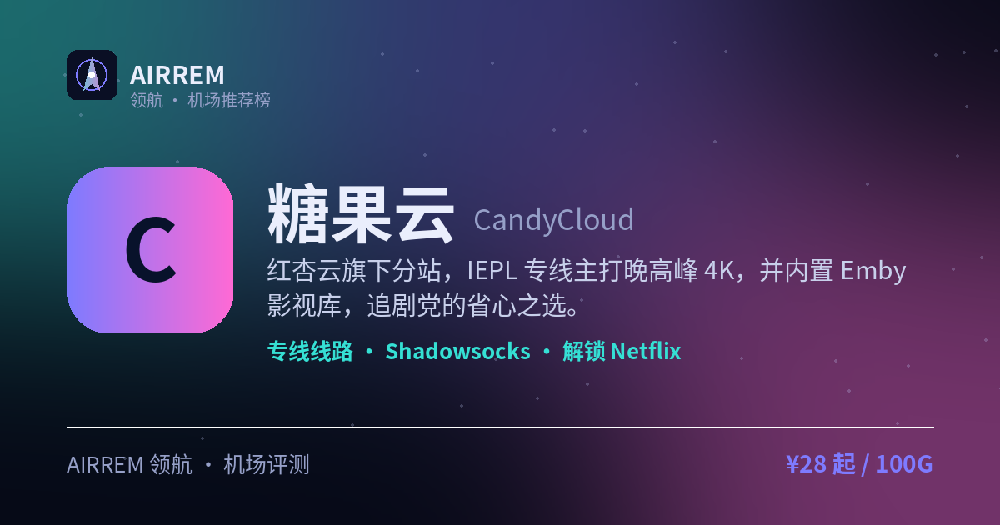

<p align="center"></p>

# 糖果云机场官网与套餐 2026：专线机场，影视追剧旗舰

> 一句话总结：影视追剧旗舰：极速定制 IEPL 专线 + 全档赠送 EMBY 私人影视库，设备不限、支持家庭共享，¥18/100G 起低门槛入手

<p align="center">
<a href="https://t.rtxk.us/t/vubhdhq"></a>
<a href="https://air-rem.github.io/candycloud/"></a>
</p>

👉 **[糖果云 官网注册入口](https://t.rtxk.us/t/vubhdhq)** ｜ 优惠码：`Candytally` ｜ [完整评测与横向对比](https://air-rem.github.io/candycloud/)

---

## 基本信息

| 项目 | 内容 |
| --- | --- |
| 机场名称 | 糖果云（糖果） |
| 成立时间 | 2025 |
| 线路类型 | IEPL 专线 |
| 支持协议 | Shadowsocks / V2Ray |
| 流媒体解锁 | Netflix / Disney+ / ChatGPT / Emby 影视库 |
| 节点地区 | 香港 · 日本 · 新加坡 等 |
| 计费方式 | 月付 / 季付 / 半年 / 年付（至 3 年付） |
| 起步价格 | ¥18 / 月 100G |
| 推荐场景 | 重度追剧党，想要 IEPL 专线 + EMBY 影视库、家庭共享 |
| Emby 影音 | 支持 |


## 糖果云是什么

糖果云（CandyCloud）是 2025 年新开的一家专线机场，为老牌机场“红杏云”的旗下分站，因此在技术与线路资源上有一定背书。它主打影视娱乐场景：IEPL 专线保证晚高峰 4K，还内置了 Emby 影视库。

对追剧党来说，Emby 影视库相当于机场自带一个“奈飞 + 私人影院”，装上 Emby 客户端登录即可直接看，省去自己找片源的麻烦。

## 线路与节点

背靠红杏云，采用 IEPL 专线，主打晚高峰时段的 4K 流畅播放，延迟表现较低，适合把“看视频不卡”当第一诉求的用户。

## 协议与客户端

提供 Shadowsocks / V2Ray 等主流协议，常见客户端（Clash 系、Shadowrocket 等）都能导入使用，上手门槛低。

## 解锁与影视库

可解锁 Netflix 与 ChatGPT 等，并额外提供 Emby 影视库服务。

- 解锁 Netflix、ChatGPT 等常用服务
- 内置 Emby 影视库，自带片源，追剧免找资源
- IEPL 专线，晚高峰看 4K 更从容


## 糖果云 套餐价格

| 套餐 | 价格 | 说明 |
| --- | --- | --- |
| 轻量-月100G | ¥18 | 月付 · 100G · 300Mbps · 不限设备家庭共享 · 赠 EMBY |
| 冲浪-月200G | ¥28 | 月付 · 200G · 500Mbps · 不限设备 · 赠 EMBY |
| 高级-月600G（火爆） | ¥68 | 月付 · 600G · 800Mbps · 不限设备 · 赠 EMBY |
| 豪华-月1200G | ¥118 | 月付 · 1200G · 1000Mbps · 不限设备 · 赠 EMBY |

> 四档全部极速定制 IEPL 专线、赠送 EMBY 影视库、设备不限支持家庭共享；每月按订单日重置流量、可购买重置包，多周期可选（月付到 3 年付），仅限个人使用暂不支持退款，价格以官网实时为准。


## 优点与缺点

**✅ 优点**

- 极速定制 IEPL 专线，晚高峰 4K 流畅
- 四档全部赠送 EMBY 私人影视库，追剧免找资源
- 设备不限、支持家庭共享
- 入门 ¥18/100G 门槛低，600G「火爆」为官网热销档

**⚠️ 缺点**

- 2025 年新机场，运营时间尚短
- 建议先月付小档验证，别大额年付
- 留意流量计量与解锁稳定性，先小规模试用


## 适合谁 / 不适合谁

| 👍 适合 | 👎 不适合 |
| --- | --- |
| 重度追剧、想要 EMBY 影视库的用户 | 只信老牌、追求长期稳定 |
| 把晚高峰看 4K 当刚需、要家庭共享的用户 | 偏好一次性大额年付求省心 |
| 想低门槛入手专线影视机场的用户 |  |


## 我们的结论

把「看剧」做到极致的影视旗舰：全线极速定制 IEPL 专线保晚高峰 4K，四档套餐全部赠送 EMBY 私人影视库——装客户端登录即看、追剧免找片源；设备不限、家庭共享无压力，入门 ¥18/100G 门槛很低，600G 档是官网热销「火爆」款，多周期可选（月付到 3 年付）。属新锐机场，建议先月付小档验证晚高峰。


## 常见问题

**Q：Emby 影视库是什么？怎么用？**

A：Emby 是一套影视媒体库，糖果云自带片源。你只需下载 Emby 客户端，用机场提供的账号信息登录，就能像用流媒体 App 一样直接在线观看，无需自己找资源。

**Q：新机场靠谱吗？会不会跑路？**

A：糖果云 2025 年新开、背靠红杏云，但毕竟运营时间短。稳妥做法是先买月付或最低档验证稳定性，别一上来大额年付，同时再备一两家老牌机场互为容灾。


## 同类机场推荐

拿不定主意？可以再看看这几家同类型的：

- **[西部数据](https://air-rem.github.io/westdata/)** — 稳定专线党，¥17 起
- **[红杏云](https://air-rem.github.io/hongxing/)** — 流媒体 / 大流量性价比，¥20 起
- **[渔云](https://air-rem.github.io/yuyun/)** — 长期稳定 / Emby 影音，¥9 起

全部 38 家机场的横向对比与选购方法论：**[AIRREM 领航 · 机场大全](https://air-rem.github.io/airports/)**


糖果云 再好，也只是让你**连得上**。连上之后要用 Claude / GPT / Gemini，可以看看下面这个：

<p align="center">
<a href="https://i.rtxk.us/i/r37kbkg"></a>
<a href="https://i.rtxk.us/i/r37kbkg"></a>
<a href="https://guide.rtxk.us/tutorial/ai-coding/leonis-ai-cc-switch-guide.html"></a>
</p>

> ### 🦁 Leonis AI 中转站 —— 一个端点，抵达所有模型
>
> 机场解决「**连得上**」，[Leonis AI](https://i.rtxk.us/i/r37kbkg) 解决「**用得顺**」。把 **Claude、GPT、Gemini、Grok、Antigravity 等 6+ 模型** 统一成同一个 API 端点：**不改代码、不换客户端，只替换一行 Base URL**。
>
> - **原生工具直连**：Claude Code、Codex CLI、Cherry Studio、NextChat、OpenAI SDK 官方客户端直接用，不需要额外插件或魔改。
> - **全程流式不缓冲**：长回答边生成边吐字，不会卡到最后一次性蹦出来。
> - **多账号池调度**：后端多号轮询，单号被限流时自动顶上，稳定性更好。
> - **一个密钥全模型**：Claude、GPT、Gemini 共用一把 `sk-` 密钥，省心。
>
> ```bash
> export ANTHROPIC_BASE_URL=https://你的专属端点
> export ANTHROPIC_AUTH_TOKEN=sk-你的密钥
> claude
> ```
>
> OpenAI 兼容客户端填 `https://你的专属端点/v1`；也支持 cc-switch「导入到 CCS」一键导入。
> 邮箱注册几十秒，**注册即送体验额度** → **[免费注册 Leonis AI](https://i.rtxk.us/i/r37kbkg)** ｜ [cc-switch 接入教程](https://guide.rtxk.us/tutorial/ai-coding/leonis-ai-cc-switch-guide.html)

---

<sub>数据更新：2026-07 ｜ 价格、套餐与优惠码以官网实时为准 ｜ 本仓库为第三方评测整理，与 糖果云 官方无隶属关系 ｜ 请遵守当地法律法规使用网络服务。</sub>

<sub>关键词：糖果云、CandyCloud、IEPL专线、Emby机场、Emby影视库、影视机场、追剧机场、家庭共享机场、不限设备、机场推荐、Netflix解锁</sub>
